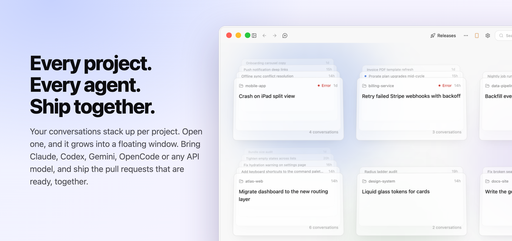
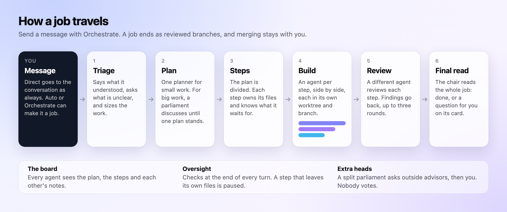
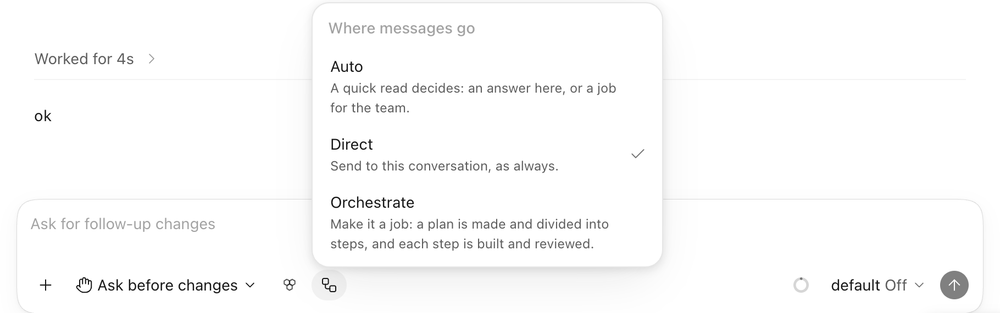
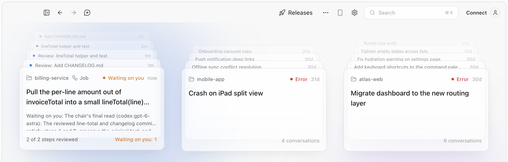

<div align="center">
  <picture>
    <source media="(prefers-color-scheme: dark)" srcset="assets/brand/xatlas-logo-dark.png">
    
  </picture>

  <p><strong>Every project, agent and release on one desk.</strong></p>
  <p>A desktop home for AI-assisted development. Your conversations stack up per project, any coding agent or model works in them, and a big request can become a job that a team of agents plans, builds and reviews.</p>
  <p>Built on <a href="https://github.com/zai-org/ZCode">ZCode</a> by Z.ai. Free and open source under Apache-2.0.</p>

  <p>
    
    
    
    <a href="NOTICE.md"></a>
    <a href="LICENSE"></a>
    <a href="#where-it-stands"></a>
  </p>

  <p>
    <a href="#build-from-source">Build</a> ·
    <a href="#quick-start">Quick start</a> ·
    <a href="#the-orchestrator">Orchestrator</a> ·
    <a href="#how-it-works">How it works</a> ·
    <a href="#where-it-stands">Where it stands</a> ·
    <a href="#xatlas-and-zcode">xatlas and ZCode</a> ·
    <a href="#faq">FAQ</a> ·
    <a href="docs/xatlas/pipeline-vision.md">Roadmap</a> ·
    <a href="CONTRIBUTING.md">Contributing</a> ·
    <a href="SECURITY.md">Security</a>
  </p>
</div>

<p align="center">
  <picture>
    <source media="(prefers-color-scheme: dark)" srcset="images/hero-dark.png">
    
  </picture>
</p>

## Why xatlas

You run many projects, many conversations and more than one AI. xatlas puts them on one calm surface: every project is a stack of its conversations, the ones that need you come to the front, and opening one grows it into a floating window you can dismiss with a click. When a request is too big for one conversation, it becomes a job for a team of agents. When the pull requests pile up, the release queue shows which ones can ship together, and why the others can't.

| Capability | What it gives you |
| --- | --- |
| **The Stack** | A grid of projects, each a stack of its conversations, most urgent in front. Fan a stack open to see the rest; click a card and the conversation grows out of it. |
| **Floating workspace** | Conversations open as a window over your projects. Terminal and side pane (browser, review, files) float above it; move and resize them freely. |
| **Orchestrator** | Send a message with **Orchestrate** and it becomes a job: a plan, divided into steps, each step built by an agent in its own worktree and reviewed by a different one. The job shows on the Stack and asks you when it needs a decision. Experimental. |
| **Parliament and swarm** | For a big job, several models open with what they found, answer each other and settle on one plan, with the dissent kept. Nobody votes; a split goes to outside advisors, then to you. The swarm button in the composer runs the quicker contest on any message: plan, debate, vote. |
| **Release queue** | Open pull requests sorted into Ship together, Needs a fix, Waiting and Drafts. Catches migration numbers that collide, merges the queue in a scratch copy to find exactly what ships cleanly together, and writes the fix brief for an agent. |
| **Bring your own agents** | Connect Claude Code, Codex, Gemini CLI and OpenCode with their own sign-ins and they appear in the model picker. Conversations run in the CLI, on your plan. API keys work too (OpenRouter, Anthropic, OpenAI, Z.ai, DeepSeek, xAI and more). |
| **One setup for every agent** | One set of MCP servers, skills, instructions and memory for every CLI. |
| **Summary at a glance** | One click shows the project, branch, changes, subagents and sources of a conversation. |
| **Yours, and local** | No xatlas account and no xatlas server. The orchestrator and the release queue never merge, push or deploy. |
| **Built on ZCode** | Skills, plugins, MCP servers, subagents, hooks and automations come from the ZCode agent runtime. |

## Build from source

xatlas doesn't ship installers yet. To run it:

```bash
git clone https://github.com/betoxf/xatlas.git
cd xatlas
pnpm bootstrap
pnpm dev:desktop:sandbox
```

> [!NOTE]
> `dev:desktop:sandbox` keeps all app data in `~/.zcode-xatlas-dev`, away from any installed ZCode. `dev:desktop:demo` does the same and starts signed out, for UI work with demo data.

### Requirements

- macOS 14 or later. Windows and Linux builds come from upstream and aren't tested here yet.
- Node.js 24.14 and pnpm 10.33 (see [mise.toml](mise.toml))
- The CLIs you want to use. The [GitHub CLI](https://cli.github.com) (`gh`) powers the release queue.

## Quick start

1. **Connect your tools.** xatlas opens on one list of tools with one button each. Sign in with the tool's own login and its row turns to **Connected**. There's no xatlas account and no server to set up. See [Connect](docs/xatlas/connect.md).
2. **Open a project.** It appears as a stack on the home screen; its conversations are the cards.
3. **Start or open a conversation.** Pick a connected agent in the model picker. Click a front card, or fan the stack open by clicking the cards behind it.
4. **Bring tools in.** Toggle the terminal or side pane from the conversation header; drag them by their top edge, resize from any edge.
5. **Hand over a bigger job.** Switch the composer from **Direct** to **Orchestrate** and send. The job appears as a card on the Stack.
6. **Ship.** Open **Releases** in the top bar, pick the project, and press **Check merge train**.

### Computer use, if you want it

[UCU (Universal Computer Use)](https://github.com/betoxf/universal-computer-use) lets agents use your Mac's apps in the background, without moving your pointer. It's optional: **Set Up** in the Connect window installs it, and **Use in all my agents** turns it on for Claude Code, Gemini CLI, OpenCode and xatlas's own agent.

## The orchestrator

<p align="center">
  <picture>
    <source media="(prefers-color-scheme: dark)" srcset="images/how-it-works-dark.png">
    
  </picture>
</p>

Every message has a route, chosen in the composer:

<p align="center">
  
</p>

- **Direct** sends it to the conversation, as always. It's the default.
- **Orchestrate** makes it a job.
- **Auto** lets a quick read decide between the two.

A job goes through the same steps a small team would:

1. **Triage** says what it understood, asks what is unclear, and sizes the work. Not everything needs a meeting.
2. **Plan.** Small work gets one planner. Big work goes to the parliament: the models open with their findings and sources, answer each other, and one of them writes the plan the others amend. It stays on what you asked: ideas beyond the request are listed apart and never reach the builders. If the parliament splits, outside advisors read both positions; if they can't settle it either, you do.
3. **Steps.** The plan is divided. Each step owns its files and knows which steps it waits for.
4. **Build.** One agent per step, side by side, each in its own git worktree and branch.
5. **Review.** A different agent reviews each step. Findings go back to the builder, up to three rounds; a dispute goes to the chair.
6. **Final read.** The chair reads the whole job. It ends as done, or as a question for you on the job's card.

<p align="center">
  
</p>

Along the way every agent can read the board (the plan, the steps and each other's notes), and code checks run at the end of every turn: a step that edits files it doesn't own is paused until you say so. Who plays each role is stored per project (there is no screen for it yet). The details are in [orchestrator-wiring.md](docs/xatlas/orchestrator-wiring.md) and [orchestrator-engines.md](docs/xatlas/orchestrator-engines.md).

> [!IMPORTANT]
> The orchestrator is new. It has run whole jobs on a demo project, and several paths have only been exercised by tests. Read [Where it stands](#where-it-stands) before you rely on it.

## How it works

- **Desktop shell:** Electron main process plus a host process for services (files, git, terminals, the release queue, the orchestrator), talking to the React UI over typed RPC channels.
- **Agent runtime:** the ZCode agent (`zcode app-server`) runs each workspace's conversations; the UI renders its conversation protocol (rows, tool calls, plans, permissions).
- **CLI agents:** a connected CLI is a model provider. Each turn runs the CLI headless in your project and streams its reply into the conversation, so its own tools, instructions and permissions apply. See [Connect](docs/xatlas/connect.md).
- **Orchestrator:** a loop in the host that moves on events (a turn ended, you decided). Its only state is an append-only ledger per project, so a job can be rebuilt from the ledger alone. Builders are ordinary conversations in managed worktrees; their commits carry trailers naming the run, the task, the agent and the model.
- **Release queue:** reads open pull requests with your `gh` login, analyses them (lanes, migrations, overlaps), and checks the merge train by merging each pull request, in order, onto the latest base in a temporary detached worktree. Nothing is pushed and your checkout is never touched.

## Where it stands

xatlas is early, and this section says so plainly.

| Area | State |
| --- | --- |
| Stack, floating workspace, Connect, CLI agents | Work in the development build on macOS. |
| Orchestrator | Experimental. Whole jobs have run on a demo project: a plan, two steps built side by side, reviews, the chair's final read. Not yet exercised in the app: the parliament as a job's planner, Auto, a second review round, a dispute, and carrying on after a restart (a restart makes the job wait for you). |
| Parliament | The discussion runs from the command line (`pnpm swarm --mode deliberate`) and has settled real questions. A sitting is several top models and about fifteen calls, so it costs more than one planner. |
| Autonomous builders | Claude Code and Codex run in their own sandboxes: they can write their worktree, temp folders and the repository's git data, and read anything. Gemini CLI and OpenCode have no sandbox, so they can't run commands unattended. |
| Release queue | Reads, analyses and dry-runs the merge train. It doesn't open, merge or deploy anything. |
| Phone | The iOS and Android apps and the relay are in the repository, but the phone remote is switched off: upstream changed its relay protocol and xatlas hasn't moved to it yet. |
| Installers, Windows, Linux | No installers. Windows and Linux are untested. |
| Checks | On a fresh clone: install, type check and lint pass, and 820 of 821 unit tests pass (the failure and one file that doesn't load are the relay's). Upstream's pre-push hook doesn't pass on this fork yet (see [CONTRIBUTING.md](CONTRIBUTING.md)), and there is no CI. |

The full list of limits is in [orchestrator-wiring.md](docs/xatlas/orchestrator-wiring.md#what-the-app-cant-do-yet).

## xatlas and ZCode

xatlas is a fork of [ZCode](https://github.com/zai-org/ZCode), Z.ai's open-source coding agent harness, and most of the code in this repository is theirs. This version is based on ZCode v3.18.2 (upstream commit `fec97590`), and upstream's history is kept in this repository's history.

| From ZCode | Added by xatlas |
| --- | --- |
| The agent runtime: tools, subagents, workflows, hooks, automations | The Stack and the floating workspace |
| Skills, plugins and MCP servers | The Connect window and conversations through Claude Code, Codex, Gemini CLI and OpenCode |
| The desktop shell, the conversation UI and the design system | The orchestrator, its engines and the parliament |
| The provider registry and API-key models | The release queue |
| Packaging for macOS, Windows and Linux | One shared setup for every CLI |
| | The phone apps and their relay |
| | xatlas's own name, identifiers and artwork |

xatlas is an independent project. It is not affiliated with or endorsed by Z.ai, and the ZCode and Z.ai names appear here only to say where the code comes from. [NOTICE.md](NOTICE.md) records the changes and carries ZCode's own notice; [docs/upstream](docs/upstream/README.md) keeps ZCode's README.

## FAQ

### Is this ZCode?

It's a fork of it with a different home screen and a team of agents on top. Anything ZCode's runtime can do (skills, plugins, MCP servers, subagents, hooks) works here. See [xatlas and ZCode](#xatlas-and-zcode).

### Do I need a Z.ai account, or any account?

No. There's no xatlas account. You sign in to the tools you already use (Claude Code, Codex, Gemini CLI, OpenCode) with their own logins, or add an API key.

### What does it cost?

xatlas is free. Conversations and jobs run on your own plans and keys, so a job costs what its agents use. A parliament sitting is the expensive part: several top models, about fifteen calls. Outside advisors are asked only when the parliament splits, and the one that goes through OpenRouter needs your own key.

### Can a job merge, push or deploy by itself?

It isn't built to. A job ends as reviewed branches in their own worktrees, merging is yours, and the release queue only tells you what can ship together. Builders are told to commit and nothing more, but they are agents with a shell: their sandbox limits where they write, and whether it blocks the network hasn't been checked.

### Where does my code go?

To the CLIs and model providers you connect. xatlas has no server of its own. [Privacy and security](#privacy-and-security) says what the code inherited from ZCode sends to Z.ai.

### Does it work on Windows or Linux?

Upstream ZCode builds for both, and xatlas keeps that code, but only macOS has been tested.

## Privacy and security

- There's no xatlas account or server. Your projects, conversations and keys stay on your machine; model calls go to the CLIs and providers you connect.
- Each CLI keeps its own sign-in. xatlas runs its status and login commands, and never reads or stores the credentials.
- xatlas adds no telemetry of its own. The code it inherits from ZCode still contacts Z.ai's servers, for example for the provider catalog, the plugin list and help content, and some of those requests can carry a device identifier. ZCode's own notice, kept in [NOTICE.md](NOTICE.md), says what is sent and when; xatlas has not audited that line by line.
- Agents act with your account's permissions. Unattended builders are confined to their worktree for writing, not for reading, and only with Claude Code and Codex. Review what you run in projects you don't trust.
- The release queue uses your own GitHub CLI login and never merges or deploys on its own.

Report suspected vulnerabilities privately as described in the [security policy](SECURITY.md).

## Repository map

```text
packages/desktop        Electron main, preload, renderer entry, packaging
packages/ui             React UI (Stack, conversation, jobs, releases, settings)
packages/services       Host services (git, terminals, release queue, orchestrator loop)
packages/orchestrator   The orchestrator's engines: ledger, routing, division, board, oversight, worktrees
packages/swarm          The parliament: discussion protocol, advisors, command line
packages/agent-share    One setup (MCP servers, skills, instructions, memory) for every CLI
packages/shared         Protocol types and pure logic shared by host and UI
packages/relay          Relay for the phone apps (switched off for now)
packages/ios            iOS app (XcodeGen project)
packages/android        Android app
packages/provider*      Model provider registry and resolution
apps/zcode-cli          The agent runtime (app-server, tools, subagents, workflows)
docs/xatlas             xatlas design notes and roadmap
docs/upstream           Upstream ZCode README (full developer and packaging guide)
```

## Project documentation

| Document | Purpose |
| --- | --- |
| [Connect](docs/xatlas/connect.md) | Connecting your tools, conversations through the CLIs, and UCU |
| [Orchestrator: wiring](docs/xatlas/orchestrator-wiring.md) | How a message becomes a job, the team's rules, and what the app can't do yet |
| [Orchestrator: engines](docs/xatlas/orchestrator-engines.md) | The ledger, routing, division, the board, oversight and worktrees |
| [Swarm and parliament](docs/xatlas/swarm.md) | Several models plan one task: a contest with a vote, or a discussion without one |
| [Shared agents](docs/xatlas/shared-agents.md) | One setup for every coding agent |
| [Roadmap](docs/xatlas/pipeline-vision.md) | What is built and what comes next |
| [Phone and releases](docs/xatlas/mobile-and-releases.md) | The phone apps and one release for desktop and mobile |
| [Upstream guide](docs/upstream/README.md) | ZCode's development, configuration and packaging guide |
| [Contributing](CONTRIBUTING.md) | Setup, checks and pull requests |
| [Security](SECURITY.md) | Boundaries and private reporting |

## Contributing

Issues and focused pull requests are welcome. Start with [CONTRIBUTING.md](CONTRIBUTING.md).

## Acknowledgements

- [ZCode](https://github.com/zai-org/ZCode) by Z.ai, which xatlas is built on and which did the hardest parts first
- [Claude Code](https://claude.com/claude-code), [Codex](https://github.com/openai/codex), [Gemini CLI](https://github.com/google-gemini/gemini-cli) and [OpenCode](https://github.com/anomalyco/opencode), the agents xatlas runs
- [UCU](https://github.com/betoxf/universal-computer-use) and [agent-desktop](https://github.com/vercel-labs/agent-desktop), for computer use
- The open-source projects listed in [THIRD-PARTY-NOTICES.md](THIRD-PARTY-NOTICES.md)

xatlas is an independent project by betoxf and is not affiliated with, endorsed by, or sponsored by Z.ai, Anthropic, OpenAI or Google. Product names and logos belong to their owners and are used only to identify the tools you connect.

## License

Apache-2.0, the same license as ZCode. See [LICENSE](LICENSE), [NOTICE.md](NOTICE.md) and [THIRD-PARTY-NOTICES.md](THIRD-PARTY-NOTICES.md).
