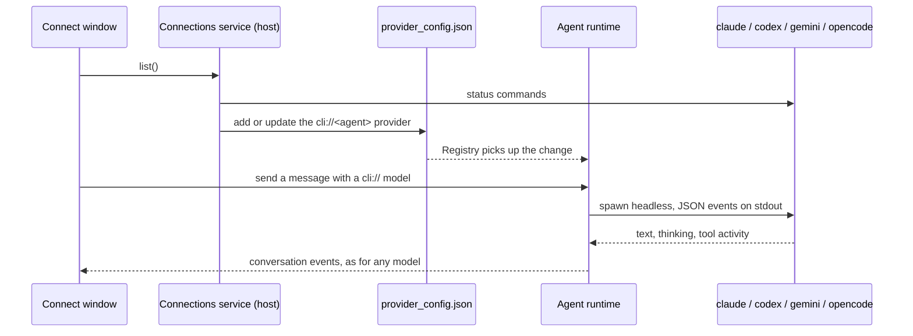
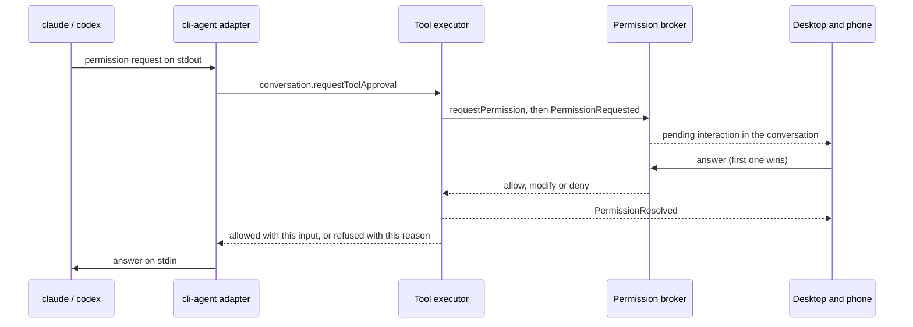

# Connect: bring your own tools

Status: first version, with approvals from Claude Code and Codex (2026-10-31).

xatlas has no account of its own. People connect the tools they already use, with those
tools' own sign-ins, and start working. The model is a plain setup window: one list, one
button per tool, and rows that turn to **Connected** by themselves.

## What a person sees

The window opens by itself on first launch, and whenever nothing is connected. It also opens
from **Connect** in the top bar and from **Settings > Connections**.

| Row            | Used for                    | Connected when                                | Button when it isn't                   |
| -------------- | --------------------------- | --------------------------------------------- | -------------------------------------- |
| Claude Code    | Conversations, swarm        | `claude auth status` says signed in           | **Sign In** runs `claude auth login`   |
| Codex          | Conversations, swarm        | `codex login status` says signed in           | **Sign In** runs `codex login`         |
| Gemini CLI     | Conversations, swarm        | Google sign-in saved, or `GEMINI_API_KEY` set | **Sign In** opens `gemini`             |
| OpenCode       | Conversations, swarm        | `opencode models` lists models                | **Sign In** runs `opencode auth login` |
| GitHub         | Release queue               | `gh auth status` says signed in               | **Sign In** runs `gh auth login`       |
| UCU (optional) | Computer use in every agent | Registered in Claude Code or OpenCode         | **Set Up**, then a switch              |

- A tool that isn't installed shows **Get …**, which opens its download page.
- **Sign In** opens Terminal on the tool's own login. Codex signs in through the browser instead,
  with `codex app-server`'s ChatGPT sign-in, and falls back to Terminal when that isn't there.
  xatlas never sees or stores a password or token: it only asks the tool. Off macOS the row shows
  the command to copy.
- While a sign-in is in progress the row is checked every three seconds, for ten minutes.
- **Plan and limits.** Claude Code and Codex rows show the plan (Max, Pro Lite, API key…) and a
  bar for each usage window with what's left and when it resets. Each CLI reports this itself,
  with no prompt sent and no token read by xatlas: Codex through `codex app-server`
  (`account/read`, `account/rateLimits/read`, `model/list`), Claude Code through its stream-json
  `initialize` and `get_usage` control requests, run in an empty folder with no MCP servers,
  hooks or saved session. Answers are reused for five minutes; **Check again** asks right away.
- The window shows the rows from last time at once while it checks them again, and checks again
  every five minutes while it's in view.
- **Later** or **Done** goes to the Stack. API keys and Z.ai accounts are one click away, under
  **Use an API key or Z.ai account**.
- Connections need nothing else: no xatlas account, no server and no special network setup.

## Conversations through the CLIs

A connected agent appears in the model picker as a provider: its default model plus the ones
it offers. Claude Code and Codex list their models themselves, so the list follows their updates. Choosing one runs the turn in that CLI, in the project's folder, on your plan.

- **It's the CLI's own agent.** Its tools, instructions, skills, MCP servers and permissions
  apply, exactly as in a terminal. Each tool call it makes is a card in the conversation, named
  for the agent and what the call touched, with its result (cut to 4,000 characters), saved and
  replayed like any other card but never run by xatlas. Codex's cards are Shell, Edit, its MCP
  tools and WebSearch; Claude Code's calls inside a subagent stay in the thinking block. OpenCode
  reports a call once it has finished, so its card appears with the result. Its answer is the
  reply.
- **Permissions.** The conversation's mode decides what the agent may do, and the CLI's own
  rules and sandbox enforce it:

  | xatlas mode        | Claude Code                      | Codex                                     | Gemini CLI  | OpenCode      |
  | ------------------ | -------------------------------- | ----------------------------------------- | ----------- | ------------- |
  | Plan               | `plan`                           | read-only sandbox                         | `plan`      | `plan` agent  |
  | Ask before changes | `default`, **asks**              | read-only sandbox, `on-request`, **asks** | `plan`      | `plan` agent  |
  | Autonomous         | `acceptEdits`                    | workspace-write sandbox                   | `auto_edit` | its own rules |
  | Full access        | `--dangerously-skip-permissions` | no sandbox                                | `yolo`      | `--auto`      |

  **Plan** is a switch on top of the other three: while it's on, the CLI runs in the Plan row
  whatever else is selected.

  **Ask before changes** really asks with Claude Code and Codex: the CLI stops, the normal
  approval appears on the desktop (and on the phone remote, when it is on), and the CLI continues
  with the answer.
  Gemini CLI and OpenCode can't stop and ask, so in this mode they stay read-only and change
  nothing. In **Autonomous**, anything a CLI would have asked about beyond the project is refused
  and it says so.

- **History.** Each conversation keeps one session per CLI, so follow-ups resume it. Switching
  CLI mid-conversation passes the transcript once as context.
- **Side calls.** Titles, commit messages and other one-off calls run in the CLI too, read-only,
  and leave no session behind. A CLI takes one prompt, so a call's system message goes at the top
  of it. Calls that replay the conversation (compaction, memory extraction, goal checks) leave it
  out: there it's xatlas's own system prompt, which a CLI doesn't use.
- **Not yet:** attachments. Stop ends the CLI and the commands it started.

### Asking from a CLI

What needs asking is the CLI's call, exactly as in a terminal. Its allow rules apply and reads
don't ask; xatlas's own project rules are for xatlas's own agent and play no part.

- The approval offers **Allow once** and **Deny**. **Always allow** isn't offered, because the rule
  would belong to the CLI and xatlas doesn't write the CLI's settings. Neither is **Full access**:
  the CLI already started with its mode.
- **Deny** tells the agent no, with any note the person typed, and it carries on from there. The
  tool doesn't run, so the file stays as it was.
- A question from Claude Code (its `AskUserQuestion` tool) appears as xatlas's question dialog, and
  the answer goes back to it.
- Approving a Codex command runs it outside the read-only sandbox. That is what the approval means,
  and it is why a command that was only reading never asks.
- If nobody can answer (no client attached, the request timed out or failed), the answer is no.
  Without a broker at all the CLI runs read-only, as Gemini CLI and OpenCode do.
- An approval takes the composer's place, as it does for xatlas's own tools, so Stop comes back
  once it's answered. **Deny** is how to say no while it's open.
- If the turn ends anyway while an approval is open, it closes: the CLI withdrew the request or
  exited, or the turn was stopped from elsewhere. Stopping also ends the CLI and its commands.
- Only the conversation's own turns can ask. Titles, commit messages and other side calls stay
  read-only.

### How it fits together

- **Owner:** the personal provider file holds which CLI providers exist; the Connections
  service is its only writer for `cli://` providers, and the sign-in itself stays with the CLI.
- **Owner of an approval:** the CLI owns the tool call and waits on it. The runtime's permission
  broker owns the pending request and takes the first answer; the `cli-agent` adapter only
  translates between the two and keeps nothing after the turn.
- A provider whose endpoint is `cli://<agent>` is a CLI agent. The schema doesn't change, so
  the file stays readable by a ZCode sharing `~/.zcode`. There the entry is a provider that
  can't connect, nothing worse.
- A signed-out CLI's provider is disabled rather than deleted, so conversations keep their
  selection and work again after the next sign-in.
- `createCliAgentModel` (`apps/zcode-cli/packages/adapters/src/model/cli-agent`) implements the
  ordinary `Model` contract, so sessions, replay and stop work unchanged, and so does the phone
  remote when it is on.

An approval, from the CLI to whoever answers it and back:

- The request lives in the session's events like any tool approval, so the desktop's live stream and
  the phone's replayable one both show it, and a client that attaches late sees it in the snapshot.
- The CLI's request id is the idempotency key: each one gets exactly one answer, and none after it
  was cancelled. The dialog has no tool row to sit on, because the CLI's tools run outside the
  conversation's cards.
- The adapter waits for what it cancelled, so `PermissionResolved` lands before the turn ends.

Claude Code (recorded on 2.1.316):

- The run adds `--input-format stream-json`, `--permission-mode default` and
  `--permission-prompt-tool stdio`. `--permission-prompts host` is the default and doesn't turn
  prompts on by itself: without the prompt tool, Claude Code refuses instead of asking. The
  explicit mode beats a `defaultMode` in the person's settings, so `bypassPermissions` there still
  asks.
- The prompt is a `user` line on stdin, and stdin stays open until the `result` line.
- It sends `control_request` with `subtype: "can_use_tool"`; xatlas answers with `control_response`,
  `behavior: "allow"` plus `updatedInput`, or `behavior: "deny"` plus `message`.
- `control_cancel_request` withdraws a request. Other control requests get an error back.

Codex (recorded on 0.166.0, where `codex app-server` is marked experimental):

- This mode alone runs `codex app-server`, JSON-RPC on stdio: `initialize`, `initialized`,
  `thread/start` or `thread/resume`, `turn/start`, and stdin closes at `turn/completed`. The other
  modes keep `codex exec`; both read and continue the same sessions.
- `approvalPolicy: "on-request"` with the `read-only` sandbox. Reads run unasked and the sandbox
  blocks every write until one is approved. `untrusted` would also ask about `ls`.
- `approvalsReviewer: "user"`, so a config that sends approvals to an automatic reviewer doesn't
  answer in the person's place.
- `item/commandExecution/requestApproval` and `item/fileChange/requestApproval` get `accept` or
  `decline`. A file change's paths and diff come from its earlier `item/started`.
  `serverRequest/resolved` withdraws a request. Other server requests get an error back.

## UCU: computer use everywhere, if you want it

[Universal Computer Use](https://github.com/betoxf/universal-computer-use) lets agents use
Mac apps in the background. It's recommended, never automatic.

- **Set Up** opens Terminal on `git clone`, then `./ucu install` and `./ucu doctor` in the
  repository's `ucu` folder, so every step is visible.
- The row says what it is before anyone opts in: agents see and use the Mac's apps in the
  background, on UCU's own engine, built on agent-desktop.
- **Use in all my agents** adds the `ucu` MCP server to Gemini CLI, OpenCode and xatlas's own
  agent; **Set Up** already registered it in Claude Code. Codex keeps its own built-in computer
  use. Turning it off removes only the entries xatlas added
  (`~/.agents/.xatlas-share.json`), and changed files are backed up in `~/.agents/backups`.
- The bundled `packages/zcode-cua` is a placeholder, so **Settings > Computer Use** is gone and
  its links lead to **Connections**.

## Acceptance

1. A new install with nothing signed in opens the window, and **Later** reaches the Stack.
2. Finishing a login in Terminal turns its row to **Connected** without a refresh.
3. A signed-in CLI appears in the model picker, a message reaches it, its reply streams into the
   conversation, and a second message resumes the same session.
4. Stop ends the CLI process.
5. A signed-out CLI's models stop being selectable, and return after signing in again.
6. UCU is off until someone turns it on, and turning it off leaves other MCP servers alone.
7. In **Ask before changes**, a file edit through Claude Code or Codex shows the approval. Approving
   applies it, and denying leaves the file alone.
8. Stop ends the CLI and the commands it started, including a command that was just approved. A
   turn that stops while an approval is open closes it, and nothing is left running.
9. The phone remote shows the same approval, and answering there settles it on the desktop
   (last checked before the phone remote was switched off; see
   [mobile-and-releases.md](mobile-and-releases.md)).
10. In **Ask before changes**, Gemini CLI and OpenCode still change nothing.
11. With **Plan** on, no CLI changes anything, whatever mode it's on top of.
