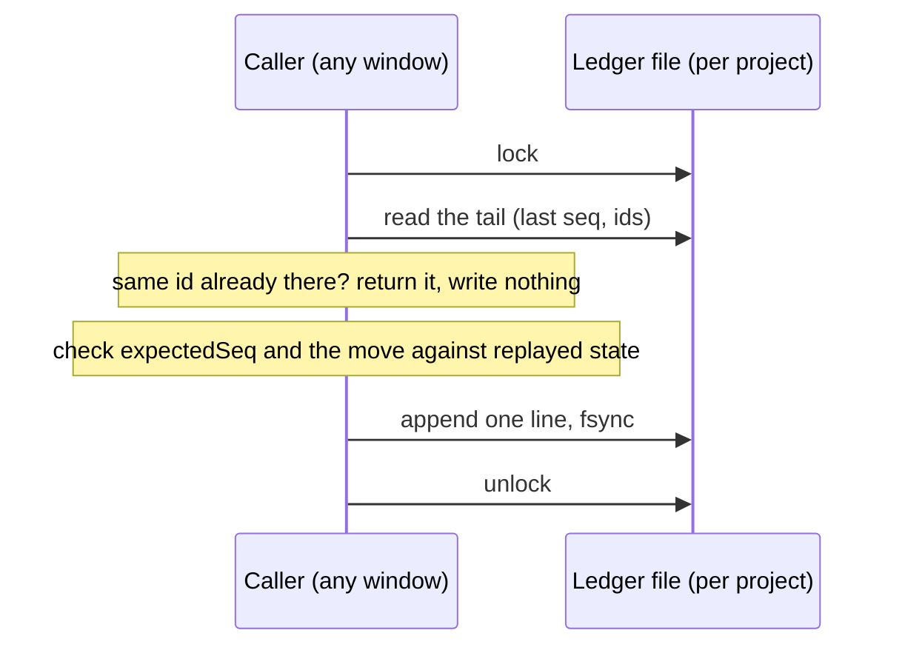

# Orchestrator engines

Status: built, reviewed and wired into the app (2026-11-15). Design:
[orchestrator-wiring.md](orchestrator-wiring.md), "The team, as the parliament decided it". Each engine was built by its own agent and
reviewed twice, read-only, by a model from another family. Its findings are fixed here except
the one under Worktrees marked as a known limit. The reviewer ran the pure test suites, not
the ones that use real files and git; those were run by the builders.

Five engines, each a plain TypeScript module with tests and no UI. The app is wired to them
later, by one owner.

| Engine     | Folder                                | Tests                                  | Owns                                             |
| ---------- | ------------------------------------- | -------------------------------------- | ------------------------------------------------ |
| Tasks      | `packages/orchestrator/src/tasks`     | `packages/orchestrator/test/tasks`     | The ledger; tasks and runs                       |
| Worktrees  | `packages/orchestrator/src/worktrees` | `packages/orchestrator/test/worktrees` | A worktree and branch per run; the run identity  |
| Routing    | `packages/orchestrator/src/routing`   | `packages/orchestrator/test/routing`   | Triage; who holds each role                      |
| Division   | `packages/orchestrator/src/division`  | `packages/orchestrator/test/division`  | Turning a plan into steps; what can run now      |
| Parliament | `packages/swarm`                      | `packages/swarm/test`                  | Weighted votes, fresh voters, effort, saved runs |

## Rules for all of them

- **Contracts are frozen.** `packages/orchestrator/src/types.ts` and the parts of
  `packages/swarm/src/types.ts` it uses change only through their owner. An engine that needs a
  change says so and carries on with what is there.
- **Engines don't import each other.** Each imports `../types.js` and Node's own modules.
  Two things come from the swarm package: its types (`@zcode/swarm/types`) and the one parser
  for the JSON in a model's reply (`@zcode/swarm/replies`), which does a bounded amount of
  work however long or odd the reply is. A caller joins the engines.
- **All IO comes in from outside:** the data folder, the repository path, the clock, the id
  maker, the function that asks a model. Tests never touch the person's real data or sign-ins.
- **No new dependencies.**
- **One owner per piece of state.** The ledger is the only truth about tasks and runs. The
  git repository is the only truth about worktrees and branches.

## Tasks: the ledger, and what replaying it gives



- **Where:** one JSONL file per project inside a data folder the caller gives. Never in the
  repository. The file name comes from a hash of `projectKey`.
- **Order of a write:** lock, read the tail, validate, append and fsync, unlock. Two windows
  writing at once still give `seq` 1, 2, 3 with no gap, and one winner for the same move.
- **Lock:** a folder holding one file that names its owner (pid, token, since when). It is
  made in private and renamed into place, so it appears whole in one step. A lock whose owner
  is no longer alive is taken over by removing that owner's file by its exact name and then
  the empty folder; a waiter with an old view can therefore never remove a fresh lock. A lock
  is never released because of its age alone. Known limit: if a crashed owner's pid now belongs
  to another program, writes time out with a message that says which lock to remove.
- **What may be written:** every entry is checked for shape before it is written, with the
  same check the reader uses, so nothing is stored that would not read back.
- **Idempotency:** an entry whose `id` is already in the ledger is a no-op and returns the
  entry that is there.
- **Replay:** a last line cut off mid-write is ignored. Any other bad line fails with an error
  that names the line; nothing is skipped silently.
- **Moves:** `TASK_MOVES` and `RUN_MOVES` decide. An illegal move throws and writes nothing.

```ts
interface LedgerOptions {
  dataDir: string;
  now?: () => Date;
  newId?: () => string;
}
interface Ledger {
  read(projectKey: string): Promise<readonly LedgerEntry[]>;
  append(
    projectKey: string,
    draft: LedgerDraft,
    options?: { expectedSeq?: number },
  ): Promise<LedgerEntry>;
}
function openLedger(options: LedgerOptions): Ledger;

interface ProjectState {
  tasks: readonly Task[];
  runs: readonly Run[];
  seq: number;
}
function replay(entries: readonly LedgerEntry[]): ProjectState;

interface Project {
  state(): Promise<ProjectState>;
  createTask(input: { title; brief; route; parentId?; dependsOn?; owns?; id? }): Promise<Task>;
  moveTask(taskId: string, to: TaskState, reason?: string): Promise<Task>;
  rerouteTask(taskId: string, to: Task["route"], reason: string): Promise<Task>;
  startRun(input: {
    taskId;
    role;
    choice;
    account?;
    conversationId?;
    worktreePath?;
    branch?;
    id?;
  }): Promise<Run>;
  updateRun(runId: string, patch: LedgerData["run.updated"]): Promise<Run>;
  record(draft: LedgerDraft): Promise<LedgerEntry>; // triage, parliament, division, notes
  /** Planned tasks whose `dependsOn` are all merged, deployed or checked. */
  readyTasks(): Promise<readonly Task[]>;
}
function openProject(ledger: Ledger, projectKey: string): Project;
```

## Worktrees: one per run, and the run's name on its work

- **`ensure`** makes the worktree and its branch for a run, from a base the caller names, in a
  root folder the caller names. Asking again for the same run returns the same worktree. It
  writes a marker file in the worktree's own git directory (not in the working tree) holding
  the run identity.
- **`adopt`** takes a worktree the host already made, which has a detached HEAD, and gives it
  the run's branch and the same marker, in place: the commit, the files and the index stay as
  they are. It checks everything before it writes anything and undoes itself when a step
  fails. Adopting again for the same run returns the same worktree; another run, a worktree
  already on a branch, or a branch name in use elsewhere is refused with a sentence the person
  can act on.
- **`list`** returns only worktrees that carry the marker.
- **`canRemove`** makes `cleanUp`'s checks and removes nothing; both go through one function.
  The host removes worktrees, so this is what the app calls.
- **`cleanUp` refuses** when the marker is missing, when there are changed or untracked files,
  when ignored files (a `.env`, an export) would be lost and the caller has not named their
  folder as disposable (a bare name such as `node_modules` covers that folder at any depth; a
  path with a slash, `packages/app/dist` or `./dist`, covers that one place),
  when the branch has commits that are neither merged into the base nor pushed, and when the
  caller says the run is still active. A branch name alone never authorises a deletion. The
  branch is kept unless the caller asks to delete it, and then only when it is merged.
- **Files the host copied in may go.** A host worktree gets copies of the files
  `.worktreeinclude` names. An ignored file that matches it and is byte for byte the main
  checkout's is a copy. One that changed, or whose original is gone, is the agent's work and
  stops the removal, named in the reason.
- **Identity** is stamped three ways and reads back the same from each: the branch name
  `xatlas/<taskId>/<agent>-<runId>`, commit trailers (`Xatlas-Run`, `Xatlas-Task`,
  `Xatlas-Agent`, `Xatlas-Model`), and a block in the pull request text. No git hook is
  installed: `withTrailers` is a pure function the caller applies, and `missingTrailers` lists
  the commits on a branch that lack them, to check before a pull request opens.
- Git runs through one injected runner. Tests use real temporary repositories.
- **Known limit:** `cleanUp` looks, then removes. A file written into the worktree between the
  look and the removal is deleted with it, ignored files included. It is called only when the
  run has ended. In the app the host removes worktrees and this engine only answers whether it
  is safe ([orchestrator-wiring.md](orchestrator-wiring.md)).

```ts
interface WorktreeRef {
  repoPath;
  path;
  branch;
  baseSha;
  identity: RunIdentity;
  createdAt;
}
function branchName(identity: RunIdentity): string;
function readBranchName(
  branch: string,
): Pick<RunIdentity, "taskId" | "agent" | "runId"> | undefined;
function withTrailers(message: string, identity: RunIdentity): string; // adding twice changes nothing
function readTrailers(message: string): RunIdentity | undefined;
function prBlock(identity: RunIdentity): string;
function readPrBlock(body: string): RunIdentity | undefined;

interface WorktreeManager {
  ensure(input: { repoPath; root; identity: RunIdentity; base: string }): Promise<WorktreeRef>;
  list(repoPath: string): Promise<readonly WorktreeRef[]>;
  missingTrailers(ref: WorktreeRef): Promise<readonly string[]>; // commit hashes
  adopt(input: { repoPath; path; identity: RunIdentity; baseRef?: string }): Promise<WorktreeRef>;
  canRemove(
    ref: WorktreeRef,
    options: CleanUpOptions,
  ): Promise<{ safe: boolean; reason?: string; discarded: readonly string[] }>;
  cleanUp(
    ref: WorktreeRef,
    options: { runActive: boolean; deleteBranch?: boolean; disposable?: readonly string[] },
  ): Promise<{ removed: boolean; refusedBecause?: string }>;
}
function createWorktreeManager(options?: { git?: GitRunner; now?: () => Date }): WorktreeManager;
```

## Routing: which way a message goes, and who does each job

- **`resolveRoute`** is pure. The person's choice wins. With "auto", a confident triage answer
  decides. An unsure one keeps the lighter route: an unsure chat stays a chat, an unsure big
  job goes direct. An unreadable or missing answer gives `direct`. The model's reply never sets the route
  by itself: it is parsed into a `TriageDecision` first.
- **`triage`** skips the model when the person already chose.
- **`pickRole`** is pure, over the settings, a snapshot of each agent and the time:
  - a choice needs its agent ready and, when the agent lists models, the model in the list;
  - quota is per agent (one sign-in per CLI), and the tightest window decides;
  - a window that is used up is skipped until its reset time has passed;
  - "unknown" limits rank below a choice with known room or no limits, and are never read as
    free; within each group the order in the settings is kept;
  - a reviewer is never the run that wrote the change, and another agent than the writer's
    comes first even when its limits are unknown: an independent review is the point, and the
    reason says so (`avoid`);
  - when nobody can take the role the answer says why, as a value, not an exception.
- **`pickParliament`** seats every member that can run and reports the ones that can't; two
  members that propose are the minimum.

```ts
function resolveRoute(preference: RoutePreference, decision?: TriageDecision): Route;
function triagePrompt(message: string): string;
function readTriage(reply: string): TriageDecision; // unreadable gives { route: "direct", confident: false }
function triage(input: {
  message: string;
  preference: RoutePreference;
  ask: (prompt: string) => Promise<string>;
}): Promise<TriageDecision>;

function pickRole(
  role: Exclude<Role, "parliament">,
  settings: RoleSettings,
  agents: readonly AgentSnapshot[],
  options: { now: Date; avoid?: AgentId },
): RoleAssignment;
function pickParliament(
  settings: RoleSettings,
  agents: readonly AgentSnapshot[],
  options: { now: Date },
): {
  seats: readonly ParliamentSeat[];
  skipped: ReadonlyArray<{ seat: ParliamentSeat; reason: string }>;
  enough: boolean;
};
function snapshotOf(agent: AvailableAgent, account?: AgentAccount): AgentSnapshot; // types from @zcode/swarm/types
```

## Division: a plan becomes steps that run side by side

A big job is always divided. The divider is asked for steps that can run at the same time
wherever the work allows, and to say so plainly when it can't be split.

- **`readDivision`** takes the last JSON object with `steps` from a model's reply.
- **`checkDivision`** finds: repeated keys, a step waiting on a key that isn't there, a circle
  of waiting, and two steps that could run together (neither waits on the other, directly or
  through others) but own the same file or folder (one path inside the other counts, and
  names that differ only by case are the same). A step that names no paths, or a path outside
  the repository, is treated as owning everything, so it runs alone.
- **`waves`** groups the steps by when they can start. **`nextSteps`** gives the steps to start
  now, given the ones done and running and a limit on how many run at once.

```ts
function divisionPrompt(input: { task: string; plan: string; maxSteps?: number }): string;
function readDivision(reply: string): PlanStep[] | undefined;
type DivisionProblem = {
  kind: "duplicate-key" | "unknown-dependency" | "cycle" | "shared-ownership";
  steps: readonly string[];
  detail: string;
};
function checkDivision(steps: readonly PlanStep[]): DivisionProblem[];
function waves(steps: readonly PlanStep[]): PlanStep[][];
function nextSteps(
  steps: readonly PlanStep[],
  state: { done: ReadonlySet<string>; running: ReadonlySet<string> },
  limit: number,
): PlanStep[];
```

## Parliament: the swarm with weights, fresh voters, effort and saved runs

- **Weights and fresh voters.** A member with `votesOnly` skips propose and debate and ranks
  every plan. Each ballot gives `weight × (plans − 1) × (k − index) / k` points, where `k` is
  how many plans that voter may rank. With every weight 1 and no fresh voters the result is
  exactly today's, and today's tests pass unchanged. Two members that propose are the minimum.
- **Ties:** points, then first places counted with weight, then the earlier letter. That order
  is no judgement of the plans, so a vote that ends level at the top is named as such:
  `tiedAtTop(scores)` gives the level plans and the result carries them as `tied`.
- **Outside advisors** break a level vote, or a deliberation's split, when any are set. They are asked in order, the
  first two together, and the next only while the ones that answered have not settled it; each
  is sent the task, the level plans and the ballots (32,000 characters at most, no repository,
  no tools). Their first choices, then a Borda count of their rankings, order the level plans
  without changing points. They are not asked when the vote decided or when fewer than two
  members gave a readable ballot. If they leave the top level, the choice is the person's. An
  advisor is Claude Code with every tool turned off, or one model through OpenRouter, whose key
  comes from `OPENROUTER_API_KEY` or the Keychain item `openrouter-api-key`, stays in memory,
  and is kept out of every error. [swarm.md](swarm.md) has the rule in full.
- **An unreadable ballot** is an abstention that the run reports.
- **Effort and fast mode** are passed to each CLI with the flag that CLI really has, checked
  against the CLI's own help. Where a CLI has no such flag the run says so in an event
  and carries on; nothing is dropped silently.
- **Saved runs:** `saveRun`, `loadRun` and `listRuns` over a folder the caller gives, with a
  version number in the file. `swarmService.ts` keeps its one-hour memory for now.

## Checks

For each engine: its package's `typecheck`, `oxlint` and `oxfmt --check` on its own files,
`pnpm architecture:check --changed`, and its tests. These must hold:

- two writers at once give gapless `seq`, and one winner for the same move;
- an illegal move writes nothing; a cut-off last line replays; a bad middle line fails;
- clean-up refuses an unmarked, a dirty and an unpushed worktree, in a temporary repository;
- the run identity reads back the same from branch, trailers and pull request text;
- used-up quota falls to the next choice, and unknown quota never beats known room;
- a division with shared ownership between side-by-side steps is reported;
- today's swarm ballots tally as before.
